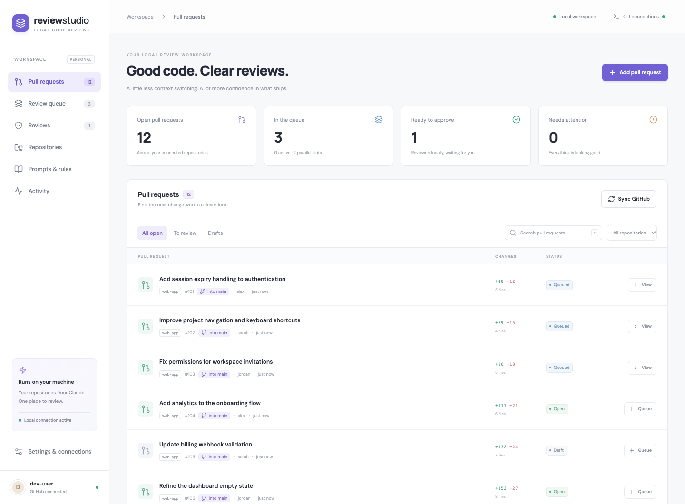
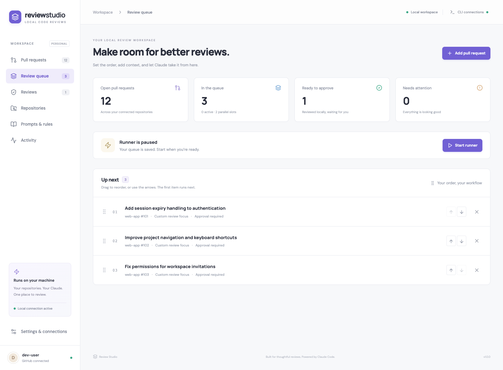
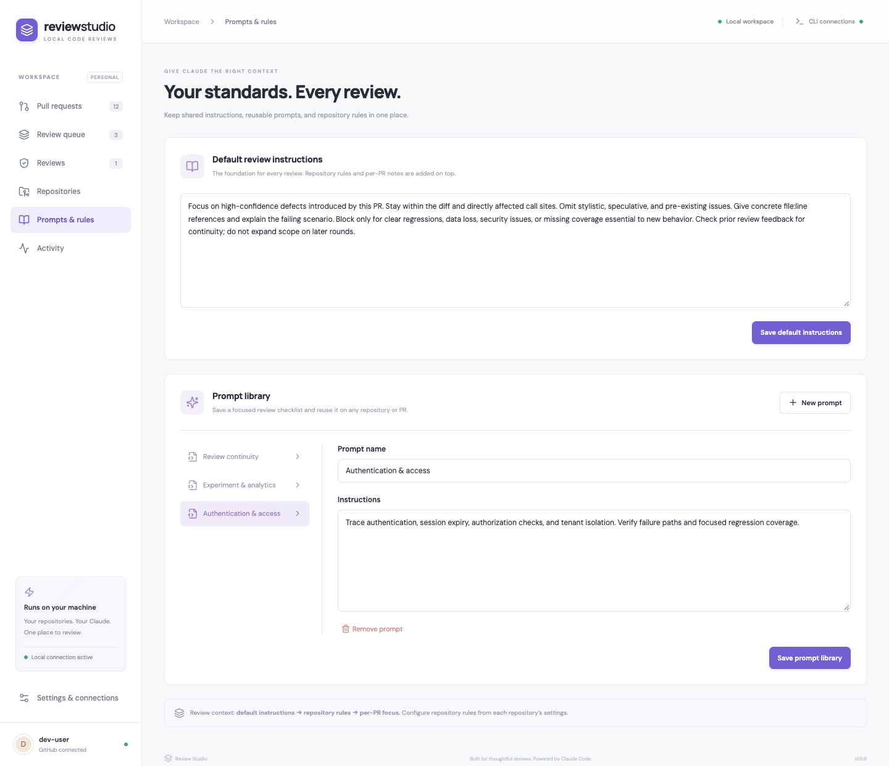

# Review Studio

**Automated GitHub pull request reviews with Claude Code, running from your own machine.**

Review Studio brings your repositories, review queue, custom prompts, and publishing controls into one desktop workspace. Connect your existing GitHub CLI and Claude Code accounts, choose repositories, and review PRs in the order that matters to you.

[](https://github.com/naveed-niazi/review-studio/actions/workflows/ci.yml)
[](LICENSE)
[](https://nodejs.org/)



_All screenshots use fictional repositories and isolated demo data._

## Why Review Studio?

- **One place for PR reviews.** Browse open pull requests, target branches, changed files, review results, and actionable errors across repositories.
- **A queue you control.** Prioritize by dragging, add a specific PR URL, set its review focus, and run up to six reviews concurrently.
- **Your review standards.** Combine shared instructions, repository rules, reusable prompts, and per-PR notes. Toggle checks for tests, analytics, security, and backward compatibility.
- **Approval or automatic publishing.** Inspect a result before posting, or opt into automatic GitHub reviews. A new installation starts paused with approval required.
- **Automatic discovery.** Choose the polling interval and age window. Newly discovered PRs and updated commits can join the queue automatically.
- **Local repository access.** Reuse a clone or browse GitHub repositories and clone from the app. Each review uses an isolated worktree at the exact PR commit.
- **Background operation.** The Mac app can stay in the menu bar and offers optional start at login in packaged builds.

Review Studio uses Claude Code for analysis and GitHub CLI for repository access. There is no Review Studio account or hosted backend to configure. Review content is sent to Anthropic through Claude Code; this is **not an offline model**.

## Quick start

The current desktop target is **macOS**. The source and Apple Silicon packaging workflow are available here; a signed, notarized installer is not yet provided. Browser/server mode is also available. Windows and Linux desktop support has not been validated.

### 1. Install the prerequisites

| Tool                                                 | Requirement                                                                                            |
| ---------------------------------------------------- | ------------------------------------------------------------------------------------------------------ |
| [Node.js](https://nodejs.org/en/download)            | 22.13 or newer, including npm                                                                          |
| [Git](https://git-scm.com/downloads)                 | Available on your PATH                                                                                 |
| [GitHub CLI](https://cli.github.com/)                | `gh`, signed into an account with access to your repositories                                          |
| [Claude Code](https://code.claude.com/docs/en/setup) | Current CLI with `--safe-mode`, `--effort`, and streaming JSON support; an eligible account or API key |

Already using `gh` and `claude`? Review Studio detects your existing sign-ins. If needed, sign in from **Settings & connections**, or use `gh auth login` and `claude auth login` in your terminal.

### 2. Launch the app

```sh
git clone https://github.com/naveed-niazi/review-studio.git
cd review-studio
npm ci
npm run desktop
```

If setup needs attention, run `npm run doctor` for a read-only prerequisite check. It reports readiness without printing account details or credentials.

### 3. Connect a repository and review a PR

1. Open **Repositories → Add repository**. Connect an existing clone, or browse your GitHub account/organization and clone a repository.
2. Set your instructions in **Prompts & rules**. Use repository settings for project-specific requirements.
3. Queue a PR from **Pull requests**, or paste a PR URL and add a focused checklist.
4. Open **Review queue → Start runner**. Review the result, then choose **Approve & publish** when ready.

For ongoing reviews, enable **Automatically queue new and updated PRs** in Settings, set your sync interval and parallel review count, and start the runner. Automatic queueing and automatic publishing are separate settings.

## See the workflow

### Prioritize your review queue



### Keep prompts and repository rules together



Use the [example prompts](examples/prompts/) as starting points. Selecting a saved prompt copies its text into a repository’s rules or a PR’s focus field. Save the form to apply it. Later edits to the library do not change copies already saved elsewhere.

## How reviews work

Review Studio fetches the PR, prepares an isolated Git worktree, and supplies Claude with its diff, description, previous feedback, and your configured instructions. The CLI receives read-only source tools; it does not receive shell or publishing tools. The app validates the result and saves it locally before publishing according to your policy.

- Reviews are **static analysis**. The app does not install project dependencies, execute tests, or run repository code. The tests toggle checks whether appropriate tests accompany a change.
- Review settings are captured when a job is queued. Requeue a job to apply updated defaults or repository rules.
- Publishing rechecks the PR’s commit. A review of an outdated commit requires a new review before publication.
- Blocking findings request changes, except on your own PRs where GitHub requires a comment. Other verdicts post comments; they do not submit a formal GitHub approval.
- Pause stops new work while active reviews finish. Failures stay visible and require a manual retry.

Read [workflow and configuration](docs/configuration.md) for discovery, storage, publishing, and cleanup details.

## Browser mode

```sh
npm run build
npm start
```

Open [localhost:8790](http://127.0.0.1:8790). Keep the server process running. This is a single-user, local application; do not expose its port to the internet.

## Development and contributions

Contributions, bug reports, documentation improvements, and focused feature proposals are welcome. See [CONTRIBUTING.md](CONTRIBUTING.md) for development setup, isolated tests, code structure, and the pull request process.

```sh
npm test
npm run build
npx playwright install chromium
npm run test:ui
```

- [Configuration and troubleshooting](docs/configuration.md)
- [Architecture and extension points](docs/architecture.md)
- [Packaging and release checklist](docs/releasing.md)
- [Report a bug](https://github.com/naveed-niazi/review-studio/issues/new?template=bug_report.yml)
- [Suggest a feature](https://github.com/naveed-niazi/review-studio/issues/new?template=feature_request.yml)
- [Security and privacy](SECURITY.md)

## License

[MIT](LICENSE). You may use, modify, and distribute Review Studio, including commercially, under the license terms. Claude Code and GitHub are separate products with their own terms and usage limits. Review Studio is an independent project, unaffiliated with Anthropic or GitHub.
